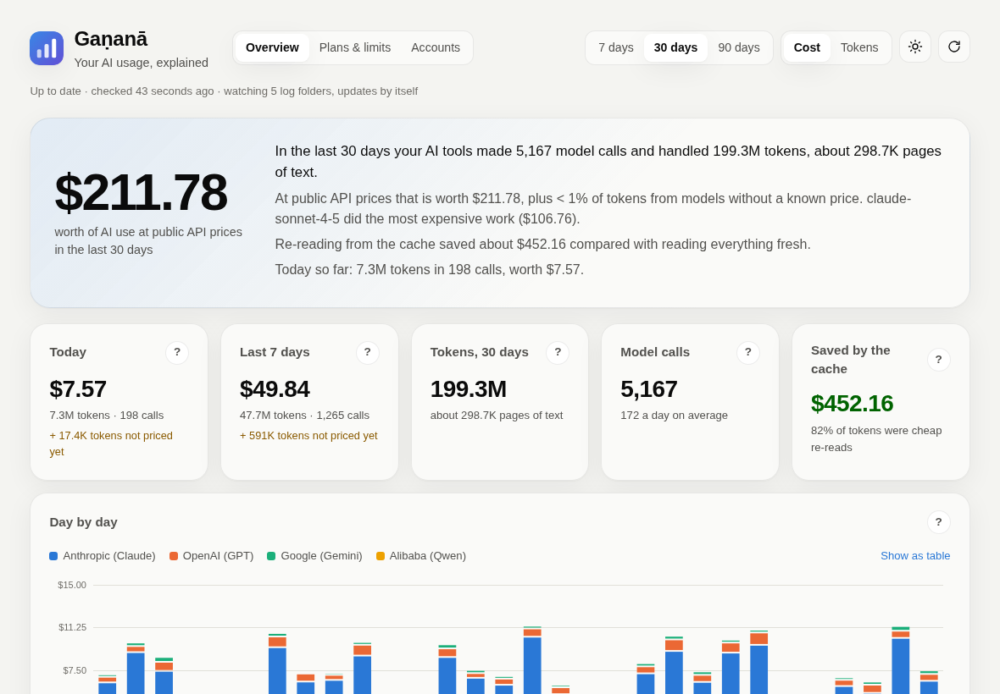
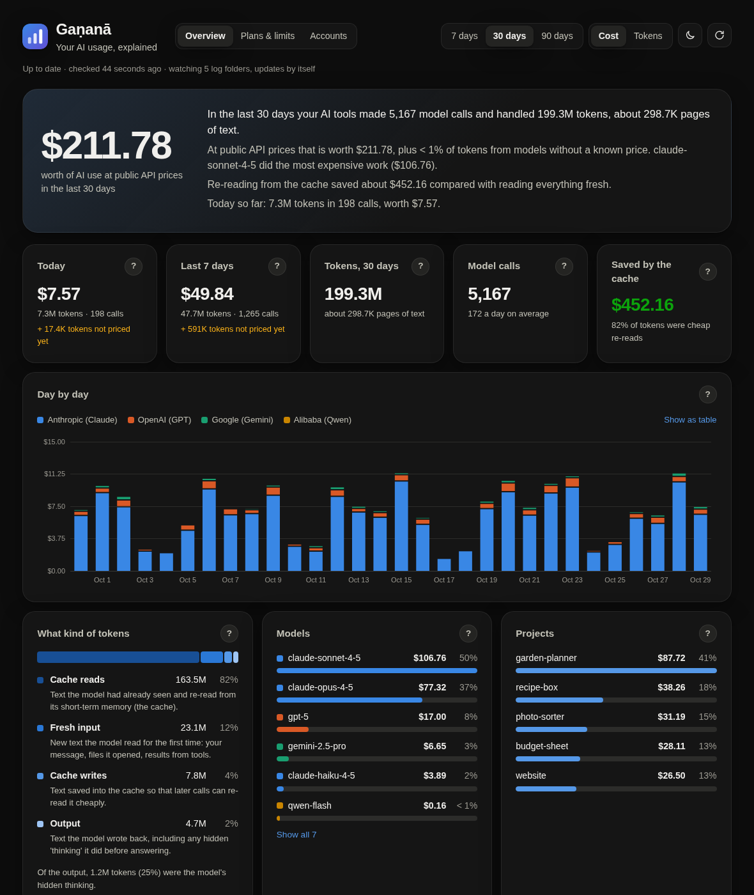
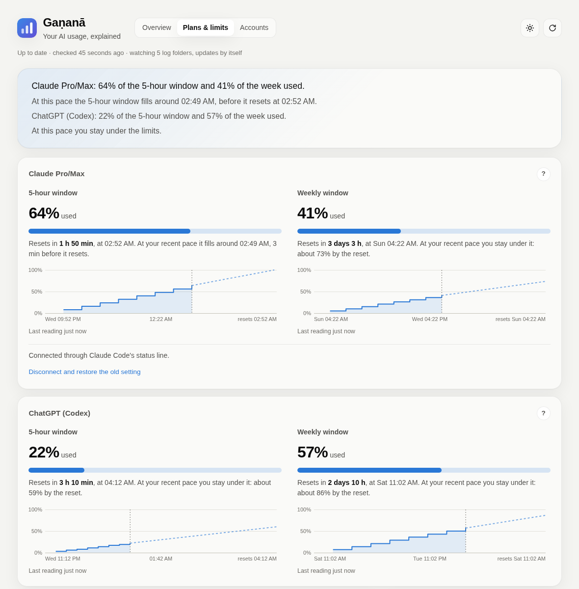
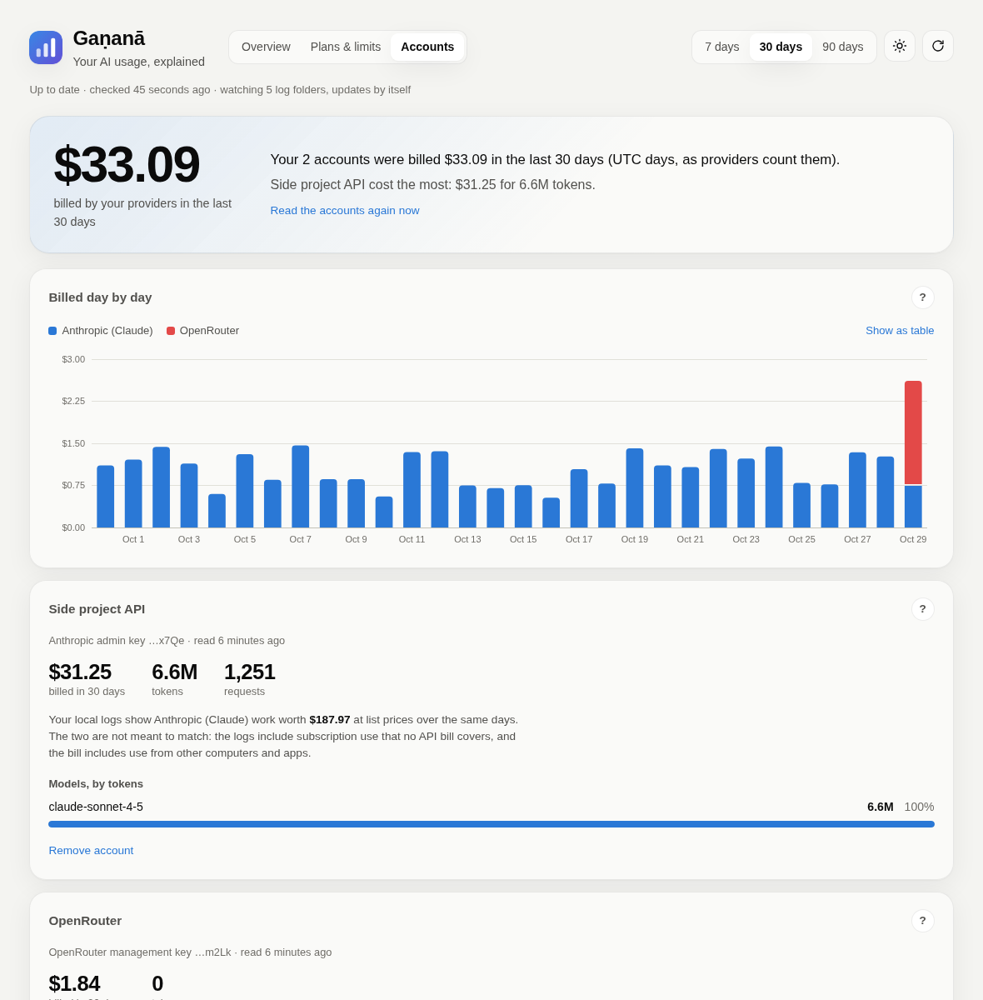
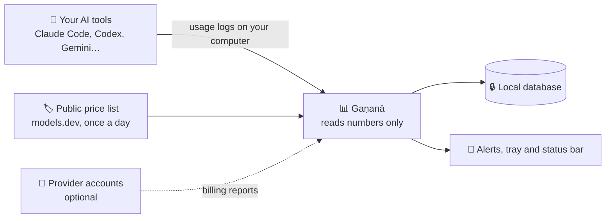

<h1 align="center">
  <br>
  <a href="https://github.com/sudharamachandranrajeev/ganana"></a>
  <br>
  Gaṇanā
  <br>
</h1>

<h4 align="center">See how much your AI coding tools use, what it would cost, and how close you are to your plan's limits.</h4>

<p align="center">
  
  
  <a href="LICENSE"></a>
  <a href="https://github.com/sudharamachandranrajeev/brahma"></a>
</p>

<p align="center">
  <a href="#-what-it-does">What it does</a> •
  <a href="#-get-started">Get started</a> •
  <a href="#-how-it-works">How it works</a> •
  <a href="#-faq-and-troubleshooting">FAQ</a> •
  <a href="#%EF%B8%8F-for-developers">For developers</a>
</p>

<p align="center">
  
</p>

Gaṇanā (गणना, "counting") is a desktop app for people who use AI coding tools such as Claude
Code or Codex. It reads the usage those tools already write on your computer and explains it in
plain words. Every number has a **?** that says what it means. Status: **early (0.1)**. There is
no ready-made Linux download yet, so on Linux you build it yourself (Step 1 below).

## ✨ What it does

- 💰 **What your AI use is worth** – tokens (the chunks of text a model reads and writes) and
  their cost at public API prices, by day, model, project and tool.
- ⏳ **Plan limits at a glance** – how full your Claude Pro/Max and ChatGPT 5-hour and weekly
  windows are, when they reset, and when you would hit them at your current pace.
- 🔔 **Warnings before you run out** – a desktop alert at 75%, 90% and 100% of a window, and an
  optional notice when it resets.
- 🧾 **Plans versus pay-as-you-go** – enter what you pay each month and see what the same use
  would cost at API prices.
- 🏦 **What you were really billed** (optional) – read the usage reports of your Anthropic,
  OpenAI or OpenRouter accounts, or import a CSV from anywhere else.
- 💻 **All your computers in one view** (optional) – share usage through a folder that Syncthing,
  Dropbox or similar keeps in step.
- 📊 **Status bar** – a usage ring in the Omarchy bar, or a line in Waybar or any other bar.
- 🔒 **Private** – it reads numbers only, never your conversations, and keeps everything on your
  computer.

Works with **Claude Code, Codex CLI, Gemini CLI, Qwen Code and opencode**.

## 📸 Screenshots

<table>
  <tr>
    <td align="center"><br><sub>Overview (dark)</sub></td>
    <td align="center"><br><sub>Plans &amp; limits</sub></td>
    <td align="center"><br><sub>Accounts</sub></td>
  </tr>
</table>

<sub>All screenshots show made-up usage: the real dashboard, fed by the real reports, rendered in a
browser by <code>app/demo/screenshots.sh</code>.</sub>

## 🚀 Get started

### Step 1 – Get the app

There is no published release yet. Pick your computer:

| Your computer | How to get it | Works on |
| --- | --- | --- |
| 🪟 Windows | The installer from the latest **Build** run (below) | Windows 10 and 11 |
| 🐧 Linux | Build it from source (below), about 5 minutes | Any 64-bit Linux with WebKitGTK 4.1, including Omarchy |

<details>
<summary><b>🪟 Windows: download the installer</b></summary>

1. Sign in to GitHub. (GitHub only lets signed-in users download build files.)
2. Open the [Build runs](https://github.com/sudharamachandranrajeev/ganana/actions/workflows/build.yml)
   and click the newest one with a green tick.
3. Under **Artifacts**, download `ganana-windows-installer` and unzip it.
4. Double-click the `…-setup.exe` inside.
5. Windows may say *"Windows protected your PC"*. This appears because the app isn't paid-signed,
   not because it is harmful. Click **More info → Run anyway**.
6. Follow the installer, then open **Ganana** from the Start menu.

</details>

<details>
<summary><b>🐧 Linux: build from source</b></summary>

1. Install [Rust](https://rustup.rs), [Node.js](https://nodejs.org) 22 and the
   [Tauri system packages](https://tauri.app/start/prerequisites/) for your distribution. On Arch
   and Omarchy:
   ```sh
   sudo pacman -S --needed webkit2gtk-4.1 base-devel curl wget file openssl appmenu-gtk-module libappindicator-gtk3 librsvg xdotool
   ```
2. Build it:
   ```sh
   git clone https://github.com/sudharamachandranrajeev/ganana
   cd ganana/app
   npm install
   npx tauri build --no-bundle
   ```
3. Put the program where your system finds it, then start it:
   ```sh
   install -Dm755 ../target/release/ganana ~/.local/bin/ganana
   ganana &
   ```

</details>

### Step 2 – First look

There is nothing to set up. Gaṇanā finds your AI tools' logs, reads them and opens the
**Overview**:

1. The big number is what the last 30 days would cost at public API prices. Switch between
   **7 days**, **30 days** and **90 days** at the top, or between **Cost** and **Tokens**.
2. Click any **?** for a plain explanation of that card.
3. If a card says **Models without a price**, match each one to a real model so it gets priced.

Closing the window keeps Gaṇanā in the tray, so alerts still arrive. Use **Quit** in the tray menu
to stop it.

### Step 3 – See your plan limits

Open **Plans & limits**.

- **ChatGPT (Codex)** windows appear on their own, from the Codex CLI logs.
- **Claude Pro/Max**: click **Connect Claude**. Gaṇanā becomes Claude Code's status line (after
  saving a backup of your setting) and keeps any status line you already had working.
- Under **Your plans**, click **Add a plan** and enter its monthly price and renewal day, to compare
  it with API prices.

> [!IMPORTANT]
> Before you uninstall Gaṇanā, click **Disconnect and restore the old setting** on Plans & limits.
> Otherwise Claude Code keeps calling a program that is gone.

### Optional steps

- **Status bar**: on Omarchy, click **Add to bar** on Plans & limits. For Waybar and other bars,
  see [`ganana bar`](docs/reference.md#status-bar).
- **Billed usage**: on **Accounts**, add an Anthropic or OpenAI admin key, an OpenRouter
  management key, or import a CSV. Keys stay in your system keyring.
- **Several computers**: on **Accounts → Your other computers**, click **Share usage between
  computers** and pick a synced folder. Do the same on each computer.

Every detail (log folders, alerts, bar formats, account keys) is in
[Gaṇanā in detail](docs/reference.md).

## 🧭 How it works



- **It reads what your tools already write.** Claude Code, Codex and the others log every model
  call. Gaṇanā reads the token counts, model names, times and project folder names, and nothing
  else.
- **It prices them** with the public price list from [models.dev](https://models.dev),
  downloaded once a day. A built-in copy is used when you are offline.
- **It stays on your computer.** The only other network calls are the provider accounts you add.
  Their keys live in the system keyring, never in the database.
- **Sharing between computers** writes numbers only (no prompts, no keys) to a folder you choose.

## ❓ FAQ and troubleshooting

<details>
<summary><b>Is this what I actually pay?</b></summary>

No. It is what the same use would cost at public API prices. On a Claude or ChatGPT subscription
you pay the plan price instead; add your plan on **Plans & limits** to compare the two. To see real
bills, add your provider accounts on **Accounts**.
</details>

<details>
<summary><b>The dashboard is empty</b></summary>

Gaṇanā only sees tools on this computer, in their usual folders. Use one of the supported tools
once, then press the refresh button at the top right. The line under the title shows how many log
folders it is watching. The full list of folders is in the [details page](docs/reference.md#which-logs-it-reads).
</details>

<details>
<summary><b>My Claude limits don't show</b></summary>

Claude Code only reports them to its status line. Click **Connect Claude** on **Plans & limits**,
then use Claude Code once. The windows appear after its next reply.
</details>

<details>
<summary><b>Does Gaṇanā see my prompts or code?</b></summary>

No. It reads only token counts, model names, times and folder names, and it never stores or sends
your conversations.
</details>

<details>
<summary><b>Windows says the app might be unsafe</b></summary>

The installer isn't code-signed (a paid certificate). Click **More info → Run anyway**.
</details>

<details>
<summary><b>How do I stop it completely?</b></summary>

Closing the window only hides it. Right-click the tray icon and choose **Quit**.
</details>

## 🛠️ For developers

<details>
<summary>Build, test and screenshots</summary>

You need Rust (stable), Node 20.19+ or 22.12+ and the
[Tauri 2 system dependencies](https://tauri.app/start/prerequisites/).

```sh
cd app
npm install
npx tauri dev              # run in development
npx tauri build            # build installers
npm run check              # type-check the dashboard

cargo test --workspace     # core library tests
cargo run --release -p ganana-core --example scan -- /tmp/ganana-test.db 30   # report from this machine's logs
app/demo/screenshots.sh    # re-render docs/screenshots from made-up usage
```

- `core/`: Rust library: log parsers, SQLite store, price catalogue, reports.
- `app/`: Tauri 2 shell (`src-tauri/`) and Svelte 5 dashboard (`src/`).
- `integrations/omarchy/`: the Omarchy bar widget.
- CI tests on Linux and Windows and builds the Windows installer (`.github/workflows/build.yml`),
  by hand or for a `v*` tag.

</details>

<details>
<summary>Roadmap so far</summary>

1. Local logs, prices and the overview dashboard.
2. Plan limits: Claude Pro/Max and ChatGPT usage windows, with warnings.
3. Provider accounts: Anthropic, OpenAI and OpenRouter reports, CSV import.
4. Status bar: `ganana bar`, an Omarchy widget, reset notifications.
5. Windows, and usage from several computers through a synced folder.

</details>

<details>
<summary>Credits</summary>

- [Tauri](https://tauri.app), [Svelte](https://svelte.dev) and [Vite](https://vite.dev)
- [rusqlite](https://github.com/rusqlite/rusqlite) (SQLite), [chrono](https://github.com/chronotope/chrono),
  [serde](https://serde.rs), [ureq](https://github.com/algesten/ureq), [csv](https://github.com/BurntSushi/rust-csv),
  [walkdir](https://github.com/BurntSushi/walkdir) and [notify](https://github.com/notify-rs/notify)
- [keyring-core](https://crates.io/crates/keyring-core) for the system keyring
- Prices from [models.dev](https://models.dev)

</details>

## Related

Gaṇanā sits alongside the **Brahma** family of private, self-hosted apps.

| App | What it does |
| --- | --- |
| [brahma](https://github.com/sudharamachandranrajeev/brahma) | The shared core and the all-in-one app |
| [bhandara](https://github.com/sudharamachandranrajeev/bhandara) | See what fills your disks |
| [bahya-nireekshana](https://github.com/sudharamachandranrajeev/bahya-nireekshana) | See how much internet data you use |

## License

[MIT](LICENSE).

---

> GitHub [@sudharamachandranrajeev](https://github.com/sudharamachandranrajeev)
